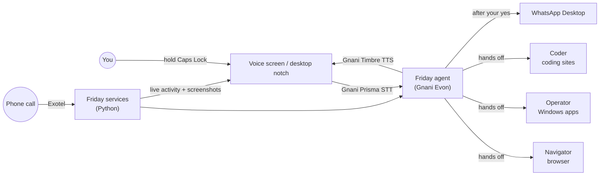

<div align="center">

# Friday

### Your voice-first AI assistant for India.

Talk to Friday in Hindi, English or Hinglish, and it gets things done on your own PC: it opens apps, works websites in a browser you can watch, sends WhatsApp messages, answers your phone calls and remembers what matters to you.

Built for the **Gnani AI #GreatIndianAIInternshipChallenge**.

</div>

---

## What Friday can do

- **Talk naturally.** Say **"Hey Friday"** or hold Caps Lock anywhere and speak. Friday answers out loud, sentence by sentence, and stops the moment you talk over it. Clap twice to bring up the voice screen. The wake word is heard on your PC by a small offline model; nothing is sent until you speak your request.
- **Instant, with no AI call.** "Open Notepad", "chrome kholo", "Chrome left, Notepad right", "full screen Chrome on my big screen", "search YouTube for lofi", "Arijit Singh bajao", "volume 40" run straight away.
- **Learns as you use it.** When Friday finishes an action once, it remembers the steps; next time the same ask (in any order, or about another app) runs instantly. Teach your own: "When I say focus mode, open Spotify and put Chrome on the left."
- **Says hi when you call it.** "Hey Friday" or a double clap, and Friday answers about what's on your screen ("Hi! You're on Two Sum in Chrome. Want me to explain this problem?"), then listens.
- **Hermes Agent drives the browser.** Multi-step web jobs go to [Hermes Agent](https://github.com/NousResearch/hermes-agent) in Friday's own Chrome window, using your Evon model. It keeps its own memory and skills, so it gets better at sites it has used before.
- **Watch for me.** "Tell me when the download is done" or "let me know when the build says succeeded": Friday checks the window every few seconds on your PC and speaks up when it happens.
- **Windows across screens.** Halves, quarters, center or full screen, on the laptop's own screen or the external monitor.
- **Work the web.** Multi-step browser tasks run in a real Chrome window on your screen, with Friday narrating each step.
- **Use your desktop apps.** Friday opens and types into Windows apps like Notepad or Calculator.
- **WhatsApp for you.** It finds the right chat, reads your message back and sends it or starts a call only after you say "yes" or "haan".
- **Answer and make phone calls.** Call Friday's number and it does what you ask. Anyone else who calls is greeted politely, and Friday takes a message without sharing anything about you. Friday can also call you or your contacts, now or on a schedule.
- **Google account.** Gmail, Calendar and Drive, with email sent only after your approval.
- **Coding practice.** Friday reads a LeetCode or HackerRank problem, writes a solution and runs the sample tests. It refuses live contests and proctored tests.
- **Media, files, meetings and reminders.** Control playback and volume, find files, join meetings and set reminders.
- **Memory.** Ask Friday to remember something and it does. Memories and voice conversations are saved as Markdown notes in an Obsidian vault, and Friday searches them to recall earlier context.

## How it works



Friday is a team of agents:

| Agent         | Job                                                                                               |
| ------------- | ------------------------------------------------------------------------------------------------- |
| **Friday**    | The one you talk to. Does one-step jobs itself and hands bigger jobs to a helper.                 |
| **Navigator** | Drives Chrome on your screen and plans multi-step web tasks.                                      |
| **Operator**  | Opens and works Windows apps through Windows UI Automation.                                       |
| **Coder**     | Solves problems on coding practice sites in the browser.                                          |
| **Reception** | Answers phone calls from anyone who isn't you. It takes a message and shares nothing about you.   |

### Gnani models

| Model           | Job                                                 |
| --------------- | --------------------------------------------------- |
| **Evon v3.3**   | The brain of every agent                            |
| **Prisma v2.5** | Speech-to-text, streamed live while you speak       |
| **Timbre v2.5** | Every word Friday says, streamed as it is generated |

A backup model (for example Gemini) takes over when the main one is rate limited or unavailable.

## Getting started

### You need

- Windows, **Node.js 24+**, npm, Python and [uv](https://docs.astral.sh/uv/) (`python -m pip install uv`)
- Google Chrome, and WhatsApp Desktop signed in to your account
- A Gnani API key and Evon endpoint (from the challenge dashboard)
- A free CopilotKit account for conversation storage: `npx copilotkit@latest login`, then `npx copilotkit@latest project select`

Keep the project folder **outside OneDrive**, since syncing interferes with the dependencies and the database.

### Install

```sh
npm ci
cd friday/services; python -m uv sync; cd ../..
cd friday/hermes-agent; python -m uv sync; cd ../..   # Navigator's browser engine (Hermes)
cd friday/browser-agent; python -m uv sync; cd ../..   # optional fallback (browser-use)
```

Copy `.env.example` to `.env` and fill in at least:

| Variable                                      | What it is                                               |
| --------------------------------------------- | -------------------------------------------------------- |
| `GNANI_API_KEY`                               | Gnani speech (Prisma and Timbre)                         |
| `EVON_BASE_URL`, `EVON_API_KEY`, `EVON_MODEL` | The Evon model                                           |
| `FRIDAY_OWNER_NAME`, `FRIDAY_OWNER_PHONE`     | Your name and number                                     |
| `FRIDAY_SERVICES_TOKEN`                       | Any long random string shared by the app and services    |
| `FRIDAY_WAKE_WORD`, `FRIDAY_LEARN`            | Optional: turn off "Hey Friday" or learned shortcuts     |
| `FRIDAY_FALLBACK_*`, `FRIDAY_PRIMARY_*`       | Optional: backup model, and extra keys/models to rotate  |
| `EXOTEL_*`, `NGROK_*`                         | Optional: phone calls                                    |

### Run

In two terminals:

```sh
npm run dev               # the app
npm run friday:services   # browser, apps, WhatsApp, live voice
```

The first time, and after each update to Friday, set up the agents and their tools:

```sh
npm run friday:setup
```

The first start of the services downloads the small offline "Hey Friday" model (about 36 MB) into `friday/services/data/wake-word`.

Then open **http://127.0.0.1:5173** and hold Caps Lock to talk.

### Try saying

- "Search for dentists near Indiranagar open this evening."
- "Open Notepad and write my shopping list: milk, eggs, bread."
- "WhatsApp Priya that I'm running ten minutes late."
- "Call Rahul on WhatsApp."
- "Remember that I prefer window seats."
- "Hey Friday, when I say study time, open Notepad and play lofi on YouTube." Then just: "Study time."
- "Tell me when Chrome shows Download complete."

## Desktop notch

`friday/desktop` is a thin black pill that sits just above the taskbar. Hold Caps Lock in any app and it widens with bars that follow your voice; Ctrl + Caps Lock hides or shows it. It starts the app and services if they aren't running.

```sh
cd friday/desktop; npm install; npm run install-shortcuts
```

This adds Friday to the Start menu and the desktop.

## Phone calls

Friday has its own phone line. With an Exotel number and a free ngrok static domain set in `.env`, Friday places and answers real calls itself, hearing with Prisma, thinking with Evon and speaking with Timbre:

- **Friday calls for you:** "Call the clinic and book a check-up at 6 PM." Friday says it is your AI assistant, keeps to the goal, and reports the outcome with a transcript.
- **Friday calls you** when you ask ("call me at 5") and before deadlines, and you can ask it to do things right there on the call.
- **From your own number** you get the full assistant: everything Friday can do on the desktop, it can do on a call. Anything that needs approval is read back, and saying "yes" on the call approves it.
- **From any other number** you get Reception, which takes a message. The message is saved to your notes under the caller's contact name.

The setup is step by step in [friday/README.md](friday/README.md#call-friday).

## Pages

| Page                                             | Address                              |
| ------------------------------------------------ | ------------------------------------ |
| Main page: your details, contacts, calls, Google | http://localhost:5173/               |
| Voice screen                                     | http://localhost:5173/#/friday       |
| Desktop notch                                    | http://localhost:5173/#/notch        |
| Admin: live status of every outside API          | http://localhost:5173/#/admin        |
| Agent dashboard and classic chat                 | http://localhost:5173/#/chat         |
| Friday services (`/health`)                      | http://127.0.0.1:8765                |

## Safety

- WhatsApp messages and calls always need your yes, and Friday checks it opened the right chat.
- The browser and app helpers refuse password, card and OTP fields, never pay and never accept terms.
- Friday's browser uses its own Chrome profile, so your personal logins are untouched.
- The stop button, or saying "stop", "ruko" or "bas", halts every on-screen action.
- Phone callers other than you never reach your details, contacts or tools.

## Project layout

| Path                         | What it is                                                     |
| ---------------------------- | -------------------------------------------------------------- |
| `src/friday/client/`         | Voice screen, orb, notch, main page and admin page             |
| `src/friday/server/`         | Model settings, Gnani voice, hand-offs, memory, phone routes   |
| `src/server/`, `src/client/` | Agent runtime, chat and workspace                              |
| `friday/services/`           | Python services: browser, desktop, WhatsApp, calls, live voice |
| `friday/hermes-agent/`       | Navigator's browser engine: Hermes Agent                      |
| `friday/browser-agent/`      | Fallback browser engine (browser-use)                          |
| `friday/desktop/`            | The desktop notch app                                          |
| `friday/persona.md`, `friday/dots/` | Personas for each agent                                 |
| `friday/docs/ARCHITECTURE.md` | Design notes                                                  |
| `tests/`, `friday/services/tests/` | Tests                                                    |

## Tests

```sh
npm run typecheck; npx vitest run tests/friday
cd friday/services; python -m uv run pytest; cd ../..
cd friday/browser-agent; python -m uv run pytest; cd ../..
cd friday/hermes-agent; python -m uv run pytest
```

## Known limits

- WhatsApp automation depends on WhatsApp Desktop's control names, which an update can change.
- Friday starts WhatsApp calls but doesn't speak on them; you do.
- Some custom-drawn Windows apps don't expose enough UI Automation for Operator.
- Headphones work best; echo cancellation helps, but speakers can still be picked up.

## License

MIT. See [LICENSE](LICENSE) and [friday/CREDITS.md](friday/CREDITS.md).
